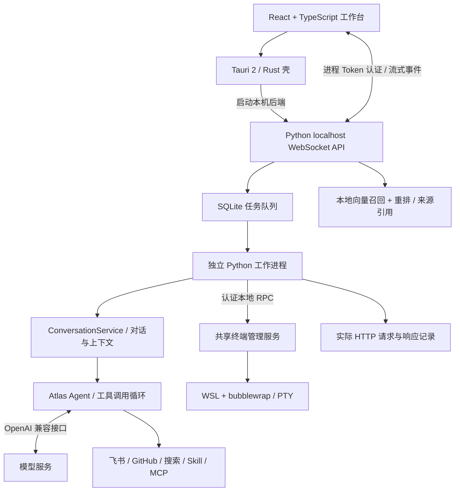

# 开发 tebb

产品介绍见 [README](../README.md)，使用和配置见 [首次使用](GETTING_STARTED.md)。本页面向需要运行源码、理解项目结构或提交改动的开发者。

## 从源码运行

需要 Python 3.11+、Node / pnpm、Rust、Tauri 的 Windows 构建依赖和 Atlas 源码。Atlas 仓库目前非公开，需要已有源码或访问权限；普通体验可使用 Windows 便携版。

```powershell
git clone https://github.com/liukun158959-beep/tebb.git
cd tebb
$atlasSource = 'E:\path\to\Atlas'
python -m pip install -e $atlasSource
python -m pip install -e .
cd client
pnpm install
pnpm tauri dev
```

## 如何工作



桌面与飞书共用 Agent 业务逻辑；普通对话和笔记问答采用不同入口。普通对话按用户选择附加技能、文档和工具，笔记模式先限制来源，再检索与生成。LLM 的流式输出由后端转为 WebSocket 事件，客户端更新气泡与任务状态。

| 模块 | 主要代码 | 职责 |
| --- | --- | --- |
| 客户端与侧栏 | `client/src/client/` | 会话、菜单、引用、文件、网页、终端与调试界面 |
| 本机 API | `desk_companion/local_api/` | Token 认证、RPC 白名单、任务及流式事件 |
| 对话执行与 Agent 组装 | `conversation.py`、`conversation_input.py`、`assistant.py` | 对话生命周期、点选校验、上下文拼接、MCP 回收、历史用量与 Atlas 调用 |
| 模型与人设配置 | `assistant_settings.py` | 参数校验、配置兼容、模型清单及连接测试，复用对话服务的状态和模型生命周期 |
| 普通会话管理 | `chat_sessions.py` | 选择、新建、清空、历史和只读记忆快照，复用任务收尾保护与既有存储 |
| 记忆编辑 | `memory_editing.py` | 长期事实增删改、单会话历史删除与摘要失效，区分两者的并发范围 |
| 任务可靠性 | `tasks.py`、`task_worker.py`、`task_process.py` | 排队、独立执行、超时、进程回收与恢复 |
| 知识与记忆 | `knowledge.py`、`context_pack.py`、`facts.py` | 文档切分、检索重排、上下文压缩与可追溯事实 |
| 视频分析 | `video.py`、`video_analysis.py`、`video_archive.py` | 字幕、分段检查点、学习笔记及归档回执 |
| 可观测与执行 | `agent_debug.py`、`terminal.py`、`sandbox_driver.py` | 全量模型载荷记录、命令管理与 Linux 沙箱策略 |

## 能力边界

- **面向个人本机使用。** 尚未提供多租户权限、服务集群或生产负载评测；不宣称高并发或企业级 SLA。
- **检索在本机完成，回答调用模型服务。** 索引是 JSON 中保存的向量、点积召回与模型重排，当前没有使用 FAISS、Milvus 等向量数据库。只有明确选择的资料才进入对应请求。
- **视频理解依赖字幕。** 没有字幕时不能分析全片，也没有声称识别视频画面；长视频失败可保留分段笔记继续处理。
- **MCP 适配有兼容范围。** 当前客户端使用 stdio、Content-Length 分帧与固定初始化版本；尚未适配标准换行分帧和 Streamable HTTP，不能保证兼容任意 MCP Server。
- **沙箱隔离取决于策略与内核。** WSL 本身不能替代隔离策略；bubblewrap 关闭网络、限制挂载与资源，自检失败拒绝执行。外部 MCP / CLI 不自动获得相同沙箱保护。
- **记忆与调试可追溯。** 对话压缩保留原始记录，模型写入事实需引用本轮用户原话。调试只能显示服务实际返回的内容，不能还原未返回的内部推理。

源码默认使用本机项目数据，发布版沿用 `%LOCALAPPDATA%/DeskCompanion`。凭据、记忆、权重和 Live2D 资源不进 Git。备份与升级参见 [使用说明](GETTING_STARTED.md)。

## 开发与验证

记忆页的 `add_fact`、`update_fact`、`delete_fact`、`delete_memory_turn` 由 `MemoryEditingService(chat_sessions)` 处理，旧 App 兼容方法和 Bridge 共用同一实例。事实编辑复用原有校验、来源记录及跨进程写锁；共享助手回复期间拒绝编辑，独立后台任务不阻止全局事实编辑，已运行回复可能保留旧快照。历史删除固定当前会话并使用同一任务保护，先验证存在，再失效覆盖该句的摘要、删除同角色同正文的全部重复记录。失败按阶段报告，不自动取消任务或回滚文件；手动压缩仍留在旧入口。见 [ADR 0006](adr/0006-memory-editing-service.md) 和 [记忆编辑验收](AGENT_DEBUG.md#无-gui-的记忆编辑服务验收)。

### 模型调用边界

普通与知识问答任务由 `task_worker` 直接使用 `ConversationService.for_session(session_id)` 执行，无需构造 `HeadlessApp`、窗口或 Bridge。服务拥有 Agent、忙碌状态及本轮回调；桌面保留窗口展示和队列派发，任务层保留权限、超时、取消与进度事件。`App` / `HeadlessApp` 通过显式门面复用服务，其他 RPC 的继承暂留。见 [ADR 0003](adr/0003-conversation-service.md)。

后台服务只读取用户配置并使用本任务会话，不保存或覆盖桌面当前选择；空白目录中也不为任务创建窗口位置配置。旧桌面仍在发送和显示完成时保存历史；后台 `run_chat` 自己保存历史与回复元数据，两条路径都只保存一次。点选规则在 `conversation_input.py` 集中维护。

对话服务的离线入口及禁止 GUI 导入的子进程验证见 [AI 对话调试](AGENT_DEBUG.md#无-gui-的对话服务验收)。

模型与人设的 9 个配置 RPC 由 Bridge 直接调用 `AssistantSettingsService`，旧 App 保留兼容方法；服务显式依赖同一个 `ConversationService`，从中读取 UserState、Agent 和忙碌状态，通过公开接口重建或绑定模型。模型网络配置继续复用 `model_network`，不另建状态或存储。服务可以独立于 GUI 调试，但整个 HeadlessApp 仍有 GUI 继承；决策见 [ADR 0004](adr/0004-assistant-settings-service.md)，测试入口见 [配置服务验收](AGENT_DEBUG.md#无-gui-的配置服务验收)。

普通会话的 5 个入口由 `ChatSessionService` 处理：`new_chat_session`、`switch_chat_session`、`clear_chat`、`load_chat_log`、`load_memory`。后台通过 `TaskManager.session_mutation_guard` 原子保护当前会话修改，覆盖任务终态之后的收尾写回；只读快照不等待宿主模型执行锁。旧桌面在发送前固定选择并预留忙碌状态，直到 GUI 回调完成历史写入后释放；界面刷新留在 App 回调，服务不导入 Bridge 或窗口。决策见 [ADR 0005](adr/0005-chat-session-service.md)，验收见 [普通会话调试](AGENT_DEBUG.md#无-gui-的普通会话服务验收)。

传统 Agent 与 `collaboration_llm.CollaborationLLM` 共用 Atlas 的 OpenAI SDK 传输、文本/思考/工具聚合和完成校验。协作适配器仅配置网络、GLM reasoning 回传及 route 低思考；工具权限、交付规则和任务进程取消仍留在产品。决策见 [ADR 0002](adr/0002-shared-model-transport.md)，公共 API 见 Atlas `docs/LLM.md`。

只有 `stop` / `tool_calls` 视为完成；仅 `[DONE]`、EOF、输出上限、过滤均抛 `IncompleteResponseError`，通过 `partial` 保留片段；不可执行片段里的工具。HTTP 状态错误统一为 SDK 异常（例如 429 为 `openai.RateLimitError`），禁用自动重试。GLM 返回的 reasoning 仅供下一轮模型回传，公开事件继续只发思考状态。协作式模型取消不能中断阻塞读取，任务进程终止和总时限继续生效。

离线调试复用 `httpx.MockTransport` 与 `atlas.testing.llm_contract.StreamContract`，测试不访问真实模型或写入外部系统：

```powershell
python -m unittest discover -s tests -p test_llm_contract.py -v
python -m unittest discover -s tests -p test_collaboration_llm.py -v
$env:DESK_TEST_ATLAS_SOURCE = 'E:\path\to\Atlas'
python -m unittest discover -s tests -p test_atlas_runtime.py -v
```

正常测试应包含累计工具回调、usage 尾帧和 GLM 回传；异常测试应保留已输出片段、关闭响应、只发送一次请求，并保持外部注入的 HTTP 客户端可用。发布回归使用 `git archive` 取得固定提交，验证 Atlas 和真实协作适配器共用契约。

```powershell
# 在项目根目录执行
python -m unittest discover -s tests -v

# 客户端
cd client
pnpm test
pnpm exec tsc --noEmit
pnpm build
cd src-tauri
cargo check --locked
```

普通测试使用临时数据和模拟服务；真实沙箱验证需显式开启环境开关，命令见 [终端说明](TERMINAL.md)。界面截图使用当前客户端组件与匿名演示资料，终端截图执行了真实沙箱命令。

提交遵循本仓库约定：每项改动关联 issue，提交说明使用 `Fixes #编号: 中文说明。`，直接推送 `main`。旧入口与历史文档保留，当前行为以代码和最新功能说明为准。
