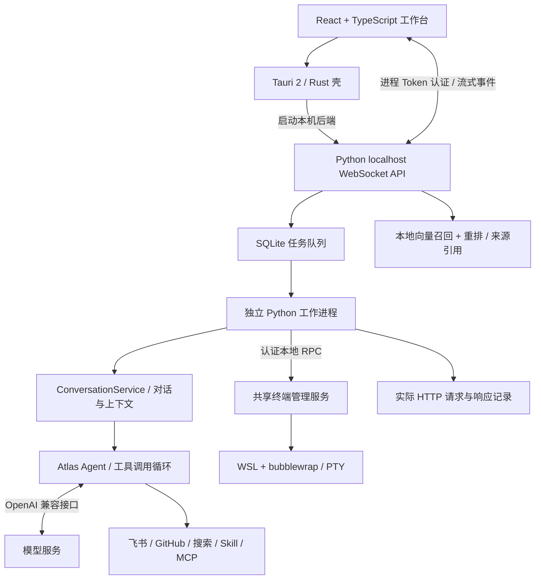

# 开发 tebb

产品介绍见 [README](../README.md)，使用和配置见 [首次使用](GETTING_STARTED.md)。本页面向需要运行源码、理解项目结构或提交改动的开发者。

## 从源码运行

需要 Python 3.11+、Node / pnpm、Rust、Tauri 的 Windows 构建依赖和 Atlas 源码。Atlas 仓库目前非公开，需要已有源码或访问权限；普通体验可使用 Windows 便携版。

```powershell
git clone https://github.com/liukun158959-beep/tebb.git
cd tebb
$atlasSource = 'E:\path\to\Atlas'
python -m pip install -e $atlasSource
python -m pip install -e .
cd client
pnpm install
pnpm tauri dev
```

## 如何工作



桌面与飞书共用 Agent 业务逻辑；普通对话和笔记问答采用不同入口。普通对话按用户选择附加技能、文档和工具，笔记模式先限制来源，再检索与生成。LLM 的流式输出由后端转为 WebSocket 事件，客户端更新气泡与任务状态。

| 模块 | 主要代码 | 职责 |
| --- | --- | --- |
| 客户端与侧栏 | `client/src/client/` | 会话、菜单、引用、文件、网页、终端与调试界面 |
| 本机 API | `desk_companion/local_api/` | Token 认证、RPC 白名单、任务及流式事件 |
| 对话执行与 Agent 组装 | `conversation.py`、`conversation_input.py`、`assistant.py` | 对话生命周期、点选校验、上下文拼接、MCP 回收、历史用量与 Atlas 调用 |
| 模型与人设配置 | `assistant_settings.py` | 参数校验、配置兼容、模型清单及连接测试，复用对话服务的状态和模型生命周期 |
| 普通会话管理 | `chat_sessions.py` | 选择、新建、清空、历史和只读记忆快照，复用任务收尾保护与既有存储 |
| 记忆编辑 | `memory_editing.py` | 长期事实增删改、单会话历史删除与摘要失效，区分两者的并发范围 |
| 手动上下文压缩 | `context_compression.py` | 同步压缩生命周期、会话预留与分阶段保存，模型等待不持有全局锁 |
| 笔记与生成文件服务 | `notebook_service.py`、`notebook.py`、`notebook_platform.py` | 基础读写、来源问答、勾选总结、导出及生成文件操作；共享忙碌准入、模型完成校验、跨进程存储和分阶段失败回执，外部操作通过适配器注入 |
| 知识库管理服务 | `knowledge_service.py`、`knowledge.py` | 八个同步管理/试问入口、后台下载准入；设置和索引快照、计算后复验提交，以及模型跨进程使用/修改保护 |
| 自动化配置与调度 | `automation_service.py`、`automation.py`、`runtime_instance.py` | 四 RPC、队列与活跃生命周期、执行快照及本地回执补写，配置原子事务；进程启动运行权覆盖收尾 |
| 周复盘服务 | `weekly_review.py` | 生成、三种飞书发布路径、共享忙碌准入、材料日期固定与发布快照核对；RPC 和自动化共用，无 GUI 依赖 |
| 今日看板服务 | `board_service.py`、`board_data.py`、`client/src/client/board-actions.ts` | 四入口业务回执、独立远端操作资源、分区合并与跨日保护；前端保留失败输入、读取顺序及行内错误 |
| 业务工作看板 | `work_items.py`、`work_board.py`、`client/src/client/work-board-state.ts`、`work-board.tsx` | 纯事项规则与持久回执分工；四阶段事项、归档和伙伴执行关联，版本事务、操作去重与按事项保存/核对，不改写 AI 执行状态 |
| 任务可靠性 | `tasks.py`、`task_worker.py`、`task_process.py` | 排队、独立执行、超时、进程回收与恢复 |
| 知识与记忆 | `knowledge.py`、`context_pack.py`、`facts.py` | 文档切分、检索重排、上下文压缩与可追溯事实 |
| 视频分析 | `video.py`、`video_analysis.py`、`video_archive.py` | 字幕、分段检查点、学习笔记及归档回执 |
| 可观测与执行 | `agent_debug.py`、`terminal.py`、`sandbox_driver.py` | 全量模型载荷记录、命令管理与 Linux 沙箱策略 |

## 能力边界

- **面向个人本机使用。** 尚未提供多租户权限、服务集群或生产负载评测；不宣称高并发或企业级 SLA。
- **检索在本机完成，回答调用模型服务。** 索引是 JSON 中保存的向量、点积召回与模型重排，当前没有使用 FAISS、Milvus 等向量数据库。只有明确选择的资料才进入对应请求。
- **视频理解依赖字幕。** 没有字幕时不能分析全片，也没有声称识别视频画面；长视频失败可保留分段笔记继续处理。
- **MCP 适配有兼容范围。** 当前客户端使用 stdio、Content-Length 分帧与固定初始化版本；尚未适配标准换行分帧和 Streamable HTTP，不能保证兼容任意 MCP Server。
- **沙箱隔离取决于策略与内核。** WSL 本身不能替代隔离策略；bubblewrap 关闭网络、限制挂载与资源，自检失败拒绝执行。外部 MCP / CLI 不自动获得相同沙箱保护。
- **记忆与调试可追溯。** 对话压缩保留原始记录，模型写入事实需引用本轮用户原话。调试只能显示服务实际返回的内容，不能还原未返回的内部推理。

源码默认使用本机项目数据，发布版沿用 `%LOCALAPPDATA%/DeskCompanion`。凭据、记忆、权重和 Live2D 资源不进 Git。备份与升级参见 [使用说明](GETTING_STARTED.md)。

## 后台与旧桌面的组装边界

`local_api.host.HeadlessApp` 是独立后台组合根，显式构造现有业务服务，不继承或导入 `App` / `BoardWorkbench`。Agent、共享忙碌和回调归 ConversationService，普通 TaskManager 与 Collaboration 分别按需且并发安全地创建；协作内部队列仍独立。Bridge 保留认证白名单对应的协议适配；目录、诊断与统计七个查询集中在 `workbench_queries.py`，旧桌面薄转发到相同实现。

后台使用已有 UserState，保留已存坐标和配置；首次无配置时使用中性坐标 `(0, 0)`，不查询显示器。旧 App 仍自行初始化皮肤、屏幕位置、窗口与队列回调。飞书通过 `FeishuAgent(host, task_backed=True)` 明确选择后台任务恢复/投递路径，普通宿主默认沿用原通道回调，不再从飞书模块反向导入 API 宿主。

无 GUI 指后台不加载旧窗口框架，不代表跨平台或禁止系统交互：文件选择继续使用独立系统选择器进程，打开/定位仍经既有系统适配，失败按原协议返回。生产启动仍先取得数据目录运行权，退出顺序和有限收尾保持原状。详见 [ADR 0015](adr/0015-headless-composition.md) 与 [完整后台验收](AGENT_DEBUG.md#无-gui-的完整后台验收)。

## 开发与验证

业务工作看板通过 `load_work_board` / `change_work_item` 直接调用独立服务，与今日看板分开。复用协作 SQLite 事务以原子解除已移除项目的事项归属，不构造 TaskManager、不占模型忙碌；客户端以事项版本合并乱序回执，结果不明时保留原操作编号并显式核对。详见 [功能与接口](WORK_BOARD.md)、[ADR 0016](adr/0016-business-work-board.md) 和 [调试验收](AGENT_DEBUG.md#业务工作看板验收)。

笔记 RPC 与流式问答由 `NotebookService(chat_sessions, start_guard=...)` 提供，Bridge/传输层直接调用，旧 App 有薄兼容方法。读取不取得宿主执行锁、不占共享助手；写入、问答、总结、导出和文件操作在短准入阶段固定共享忙碌状态，宿主被占用时立即拒绝，独立后台任务继续。所有 notebook.json 写入者共用独立 ResourceLock 与原子替换，模型等待不持笔记存储锁。失败按 partial、unconfirmed、committed 报告，不自动重试；协议和验收见 [ADR 0008](adr/0008-notebook-service.md)、[笔记服务调试](AGENT_DEBUG.md#无-gui-的笔记基础服务验收)。

知识库八入口由 `KnowledgeService(chat_sessions, start_guard=...)` 提供。同步修改/试问立即准入或拒绝，页面/进度读取不等模型；计算阶段使用设置与索引快照，提交前复验，修改设置不自动重建。模型加载/推理取得共享资源使用权，下载/删除取得排他修改权，跨进程冲突立即拒绝；后台下载仅启动阶段占共享助手。来源原文与笔记引用独立保留，失败按实际阶段回执。见 [ADR 0011](adr/0011-knowledge-service.md) 和 [知识库调试](AGENT_DEBUG.md#无-gui-的知识库服务验收)。

今日看板的加载、创建日程、删除日程和删除待办由 `BoardService()` 提供，Bridge 直接调用，旧 App 的加载入口薄转发；共同底层也覆盖聊天工具、桌宠和自动化。当天缓存读取可继续，远端操作按看板资源跨进程非阻塞准入，不占模型 busy，长 IO 不持宿主、全局或缓存锁。所有缓存写入者短时加锁合并最新分区、原子替换，并检查自然日；周复盘摘要和链接写入可以与远端刷新并行。远端结果未确认、已完成但查询失败、缓存保存未确认分别报告；前端检查业务结果、保留失败输入和原列表，忽略旧读取响应。见 [ADR 0012](adr/0012-board-service.md) 与 [今日看板调试](AGENT_DEBUG.md#无-gui-的今日看板服务验收)。后台组装与去继承验收见下文。

记忆页的 `add_fact`、`update_fact`、`delete_fact`、`delete_memory_turn` 由 `MemoryEditingService(chat_sessions)` 处理，旧 App 兼容方法和 Bridge 共用同一实例。事实编辑复用原有校验、来源记录及跨进程写锁；共享助手回复期间拒绝编辑，独立后台任务不阻止全局事实编辑，已运行回复可能保留旧快照。历史删除固定当前会话并使用同一任务保护，先验证存在，再失效覆盖该句的摘要、删除同角色同正文的全部重复记录。失败按阶段报告，不自动取消任务或回滚文件。见 [ADR 0006](adr/0006-memory-editing-service.md) 和 [记忆编辑验收](AGENT_DEBUG.md#无-gui-的记忆编辑服务验收)。

手动压缩 RPC 直接使用 `ContextCompressionService`，通过会话服务与 `TaskManager.reserve_session` 短暂登记当前会话预留和共享助手忙碌，等待模型时不持有宿主锁、会话锁、队列条件锁或 WRITES，写摘要时才获取共享写锁。当前会话任务未结束时拒绝开始；压缩期间拒绝该会话新任务和共享状态修改，只读及其他会话任务/取消继续。原压缩算法、模型超时、用量记录与同步返回结构沿用，断开不等于取消，不自动重试。见 [ADR 0007](adr/0007-context-compression-service.md) 和 [手动压缩验收](AGENT_DEBUG.md#无-gui-的手动压缩服务验收)。

周复盘三个 RPC 直接调用 `WeeklyReviewService(chat_sessions, start_guard=..., open_document=...)`，旧 App/BoardWorkbench 只保留薄转发；自动化 `retro_gen/retro_write` 使用同一实例。准入阶段短暂固定共享忙碌，材料、模型、飞书和系统打开等待均不持宿主、WRITES 或存储锁；定时复盘遇到最终准入竞争保留排队，后续调度再尝试，不记录业务失败，也不阻止独立资讯任务。生成固定开始日期和材料区间，仅保存正常完整、非空、无工具调用的正文，并原子清除旧链接；发布固定正文，以日期、正文和生成时间核对本地链接登记。三条发布路径保留原有新建/覆盖、登记和打开差异，失败保留正文、目标和远端事实，不自动重跑模型或重发文档；自动化配置与完整调度生命周期现由下述独立服务处理。见 [ADR 0013](adr/0013-weekly-review-service.md) 与 [周复盘调试](AGENT_DEBUG.md#无-gui-的周复盘服务验收)。

自动化四 RPC 直接使用 `AutomationService(review=..., tasks=..., busy=..., changed=...)`；服务拥有队列、执行快照、活跃保护和收尾回执，`automation.py` 提供配置事务、校验与定时计算。调度逻辑不导入或持有 App/Bridge，旧桌面保留薄兼容方法并共享任务管理器；资讯控制器只接收明确的 TaskManager。配置写入与入队确认后列表读取失败分别报告，入队保存未确认不会安装内存队列；结果写入未确认保留活跃占用，只补写本地记录，不重跑外部动作。列表与空闲配置不等待宿主或模型，模型/飞书等待不持配置锁；排队、运行、重试和最终回写期间禁止修改、启停及删除对应作业。

生产入口在构造 App/HeadlessApp、启动飞书或恢复任务前，通过 `runtime_instance.acquire_runtime()` 非阻塞取得数据目录运行权，持有至进程结束；不在 scheduler.stop 时提前释放。第二个旧桌面/后台明确拒绝，新客户端通过子进程退出码 73 显示具体原因，不增加只读后台或跨实例跳转。停止关闭准入，服务有限收尾；未开始与结果未确认分别记录，复盘重启不自动重发，资讯沿用已有阶段/幂等保护与一次临时失败重试。调试、存储兼容和验收见 [自动化调试](AGENT_DEBUG.md#无-gui-的自动化服务验收) 与 [ADR 0014](adr/0014-automation-runtime.md)。

### 模型调用边界

普通与知识问答任务由 `task_worker` 直接使用 `ConversationService.for_session(session_id)` 执行，无需构造 `HeadlessApp`、窗口或 Bridge。服务拥有 Agent、忙碌状态及本轮回调；桌面保留窗口展示和队列派发，任务层保留权限、超时、取消与进度事件。`App` / `HeadlessApp` 分别组合已有服务：旧 App 注入 UI 回调与 pet 忙碌保护，后台注入非阻塞执行锁和任务会话保护，不共享 GUI 基类。见 [ADR 0003](adr/0003-conversation-service.md)。

后台服务只读取用户配置并使用本任务会话，不保存或覆盖桌面当前选择；空白目录中也不为任务创建窗口位置配置。旧桌面仍在发送和显示完成时保存历史；后台 `run_chat` 自己保存历史与回复元数据，两条路径都只保存一次。点选规则在 `conversation_input.py` 集中维护。

对话服务的离线入口及禁止 GUI 导入的子进程验证见 [AI 对话调试](AGENT_DEBUG.md#无-gui-的对话服务验收)。

模型与人设的 9 个配置 RPC 由 Bridge 直接调用 `AssistantSettingsService`，旧 App 保留兼容方法；服务显式依赖同一个 `ConversationService`，从中读取 UserState、Agent 和忙碌状态，通过公开接口重建或绑定模型。模型网络配置继续复用 `model_network`，不另建状态或存储。后台与服务均可脱离旧 GUI 导入；决策见 [ADR 0004](adr/0004-assistant-settings-service.md)，测试入口见 [配置服务验收](AGENT_DEBUG.md#无-gui-的配置服务验收)。

普通会话的 5 个入口由 `ChatSessionService` 处理：`new_chat_session`、`switch_chat_session`、`clear_chat`、`load_chat_log`、`load_memory`。后台通过 `TaskManager.session_mutation_guard` 原子保护当前会话修改，覆盖任务终态之后的收尾写回；只读快照不等待宿主模型执行锁。旧桌面在发送前固定选择并预留忙碌状态，直到 GUI 回调完成历史写入后释放；界面刷新留在 App 回调，服务不导入 Bridge 或窗口。决策见 [ADR 0005](adr/0005-chat-session-service.md)，验收见 [普通会话调试](AGENT_DEBUG.md#无-gui-的普通会话服务验收)。

传统 Agent 与 `collaboration_llm.CollaborationLLM` 共用 Atlas 的 OpenAI SDK 传输、文本/思考/工具聚合和完成校验。协作适配器仅配置网络、GLM reasoning 回传及 route 低思考；工具权限、交付规则和任务进程取消仍留在产品。决策见 [ADR 0002](adr/0002-shared-model-transport.md)，公共 API 见 Atlas `docs/LLM.md`。

只有 `stop` / `tool_calls` 视为完成；仅 `[DONE]`、EOF、输出上限、过滤均抛 `IncompleteResponseError`，通过 `partial` 保留片段；不可执行片段里的工具。HTTP 状态错误统一为 SDK 异常（例如 429 为 `openai.RateLimitError`），禁用自动重试。GLM 返回的 reasoning 仅供下一轮模型回传，公开事件继续只发思考状态。协作式模型取消不能中断阻塞读取，任务进程终止和总时限继续生效。

离线调试复用 `httpx.MockTransport` 与 `atlas.testing.llm_contract.StreamContract`，测试不访问真实模型或写入外部系统：

```powershell
python -m unittest discover -s tests -p test_llm_contract.py -v
python -m unittest discover -s tests -p test_collaboration_llm.py -v
$env:DESK_TEST_ATLAS_SOURCE = 'E:\path\to\Atlas'
python -m unittest discover -s tests -p test_atlas_runtime.py -v
```

正常测试应包含累计工具回调、usage 尾帧和 GLM 回传；异常测试应保留已输出片段、关闭响应、只发送一次请求，并保持外部注入的 HTTP 客户端可用。发布回归使用 `git archive` 取得固定提交，验证 Atlas 和真实协作适配器共用契约。

```powershell
# 在项目根目录执行
python -m unittest discover -s tests -v

# 客户端
cd client
pnpm test
pnpm exec tsc --noEmit
pnpm build
cd src-tauri
cargo check --locked
```

普通测试使用临时数据和模拟服务；真实沙箱验证需显式开启环境开关，命令见 [终端说明](TERMINAL.md)。界面截图使用当前客户端组件与匿名演示资料，终端截图执行了真实沙箱命令。

提交遵循本仓库约定：每项改动关联 issue，提交说明使用 `Fixes #编号: 中文说明。`，直接推送 `main`。旧入口与历史文档保留，当前行为以代码和最新功能说明为准。
