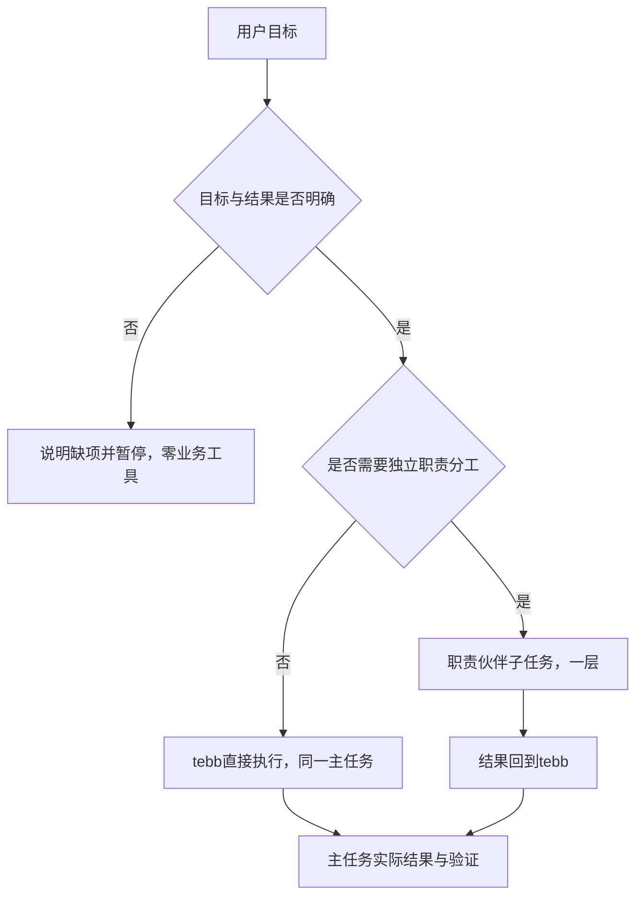

# 搜索与伙伴执行复核（2026-10-28）

对应 #152、#153、#154、#155。Q1–Q5 均已确认并实施。本文保留问题事实与参考依据；当前接口、调试和验收见 SEARCH.md、TEBB_EVOLUTION.md 及 ADR0021。

## 实际故障

- 已结束日程不能编辑来自此前的显式只读规则，多层同时限制，并非飞书自动拒绝。Q1 已接受开放普通个人历史日程的标题/时间编辑；新建过去日程与删除边界保持。
- 桌宠过程气泡没有点击监听，原来只能菜单关闭。Q2 已接受点击关闭，并复用整根任务提示的屏蔽，不取消任务。
- 模型聊天地址被固定拼成 `/v1/tool/search`。最近四次 HTTP404 后 Bing RSS 实际成功，各返回五个候选来源；正文混入原404 HTML导致整体失败的印象。另有真实 TLS EOF；资讯绕过备用服务，不能把全部入口视为已恢复。
- 仅名为 test 的事项触发规划两次，再创建 tebb 自身任务七次，整链九次；前四次读取项目，后三次交付/修订，另准备自动汇总。缺目标没有先暂停，报告交付修订也不应替代用户补充。最新 #151 只改善计划格式，不解决强制规划与自委派。

## 参考与取舍

[OpenAI Agents SDK](https://openai.github.io/openai-agents-python/multi_agent/) 将 manager 持有用户回复、职责 Agent 作为有界工具，与完全移交会话区分。tebb 采用前者的职责划分，不引入第二套 SDK/模型循环。

[Claude Code 子任务](https://code.claude.com/docs/en/sub-agents) 用独立上下文隔离探索细节，主会话接收摘要；用户能看到角色和分工。借鉴其上下文和权限边界，不把全部聊天、全工具或新模型配置无条件复制给子伙伴。

[Anthropic 的研究系统复盘](https://www.anthropic.com/engineering/multi-agent-research-system) 说明多 Agent 额外消耗较大，适合独立并行和超出单上下文的工作。不能为了简单目标强行增加规划、tebb自任务和最终汇总三个节点。

已核对当前 OpenCode 官方源码（旧 `packages/opencode/src/tool` 路径已迁移）：

- [独立搜索插件目录](https://github.com/anomalyco/opencode/blob/dev/packages/core/src/plugin/websearch/index.ts) 将搜索供应商与模型分离。
- [MCP搜索适配](https://github.com/anomalyco/opencode/blob/dev/packages/core/src/plugin/websearch/mcp.ts) 有界响应、JSON/SSE解析及请求超时。
- [职责子任务工具](https://github.com/anomalyco/opencode/blob/dev/packages/core/src/tool/plugin/subagent.ts) 传递明确分工、保留父子关系，并拒绝把 primary Agent 当子任务，默认限制深度。
- [子任务状态栏](https://github.com/anomalyco/opencode/blob/dev/packages/app/src/session/composer/subagent-bar.tsx) 显示状态、耗时、角色、模型以及返回主任务入口。

仅参考边界和协议，未复制上述项目代码。OpenCode 当前[搜索配置](https://opencode.ai/v2/docs/websearch/)亦将渠道、限流冷却与模型区分。

## 已确认的执行设计

一个主任务拥有用户目标、结果和取消。自身工作用阶段表达，子任务只代表交给其他职责伙伴的独立工作。默认聊天展示一个任务与实际结果；展开后可看分工、角色、工具、耗时、调用总数和失败阶段。旧 route/plan 树保留历史，通过派生视图归到根；局部 succeeded 不等于整链完成。Q5 已确定持久待补充、用户补充后继续同一主任务，可取消且等待期间不占模型名额。

## 搜索选择与验证设计（Q4已确认）

采用 Exa 官方公开MCP主搜索、Bing备用，模型私有搜索仅显式配置支持时使用。所有入口共用网络策略、总deadline、脱敏诊断及有限重试；404不支持、429冷却、网络临时失败、有效空结果和结构异常分别处理。搜索结果中不夹 HTML 错误，错误详情留在诊断中。

[Exa 官方说明](https://exa.ai/mcp) 提供无 key 的公开入口，仍有限流。本机只读探测：直调和标准握手均可用，SSE 返回真实官方链接。当前工具要求 query 与 objective；结果主要为 text 中的 Title/URL/Published/Highlights，没有 structuredContent。N/A 不作为发布时间，片段不升级为已读全文。此探测不等于长期SLA。

验收应分层记录：故障注入（404/401/429/5xx/TLS/超时/坏JSON/空结果/截断/取消）、入口一致性与密钥隔离、重复中英文/实体/时效查询的有效结果率和耗时分布、人工核对主题相关性与日期。返回200或五个链接不能单独作为稳定性/质量结论。
